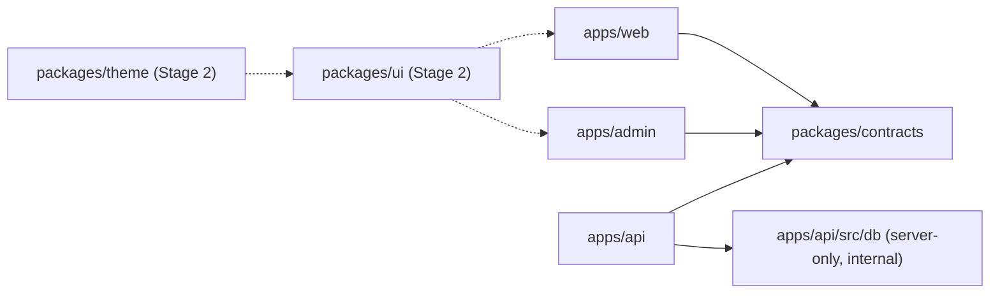

# Stage 1 — Repository setup plan

**Date:** 2026-10-26 · **Baseline:** `68c27ae` on `staging` · **Status:** Proposal awaiting approval. No files moved, no dependencies changed, no migrations applied.

Companion: [02-database-architecture.md](02-database-architecture.md).

> **Implementation status (2026-10-26, branch `chore/repo-setup-step1`, not yet committed or deployed).** Steps 0–7 are implemented. Sections 2–11 below are kept as written and describe the *pre-change* baseline (old `client/`/`server/` paths are intentional there). Differences from the plan:
>
> - **Turborepo adopted** at the owner's request: `turbo@2.5.4` on top of npm workspaces; `turbo.json` defines `typecheck`, `build` (cached, `VITE_*` and `.env*` hashed), `test` (uncached — api tests read web sources) and `dev`. `concurrently` was removed because turbo replaces it.
> - **Single service-role client stays at `apps/api/src/services/db.ts`** (it already existed and had 7 importers) rather than a new `src/db/client.ts`; the 5 duplicate clients now import it.
> - **Logger not moved** to `src/lib/`. Renaming it gives no benefit until the redaction work (S07/S23).
> - **`packages/contracts` has one runtime dependency** (`libphonenumber-js`, the same version as before), required by the shared `validateContactInput`.
> - **Lockfile:** the root lockfile was seeded from the old ones. Result: zero runtime package changes, zero direct-dependency drift; only build-toolchain transitive patch/minor bumps (rollup, esbuild, postcss, babel, browserslist).
> - **Verified:** from a clean `npm ci`, typecheck and build pass for all 4 workspaces; the web bundle is the same 1,652,264 bytes as the baseline (only minifier names differ); tests 76/77, where the 1 failure is the pre-existing `leadQueryClient` assertion; the boundary check passes and catches planted violations; the API boots from a simulated image install (176 packages, same as before) and serves `/health` and `/widget/loader.js`. **Docker images were not built** (no Docker daemon on the workstation), so CI's first image build is the confirming check. Audit inputs: [docs/audit/](../audit/). Every claim about the audit was re-checked against the source tree on this date; references below point to the source, not the report.

---

## 1. Summary of the recommendation

| Decision | Recommendation |
| --- | --- |
| Tooling | **npm workspaces**, one root lockfile. No pnpm, Turborepo or Nx. |
| Apps | `apps/web` (current `client/`), `apps/api` (current `server/`), `apps/admin` (new, scaffold only, **not deployed** until staff authentication exists). |
| Shared packages now | **Only `packages/contracts`.** It is the only shared package with concrete duplication to remove today. |
| Shared packages deferred | `packages/ui` and `packages/theme` → Stage 2. `packages/config`, `packages/logger`, `packages/db` → created only when a second server runtime needs them (until then they live inside `apps/api`). |
| Database | Migrations move to repo-root `supabase/` (the database is shared by web/RLS, api and future admin; it is not owned by one app). Moved in its own step. |
| Infrastructure | `Call/dograh-docker` → `infra/dograh-docker/`. **Compose files stay at repo root** until the EC2 host layout is verified (see §8.3). |
| Migration style | Seven small, separately revertible PRs. Pure moves are kept apart from tooling changes and from any behavior change. |

The proposed tree from the brief is mostly sound. I disagree on three points: (1) creating `config`, `logger` and `db` packages now would mean packages with one consumer; (2) moving the Compose files can break production `env_file` resolution; (3) `ui`/`theme` belong to Stage 2 and should not be created empty.

---

## 2. Current state (verified)

| Area | Observed | Evidence |
| --- | --- | --- |
| Packages | Three independent npm packages, three lockfiles. Root orchestrates them with `--prefix`. No `workspaces` field. | `package.json:5-12`, `client/package-lock.json`, `server/package-lock.json` |
| Root deps | `concurrently`, `supabase` CLI. Also `gsap`, which nothing imports. | `package.json:14-20`; grep of `client/src`, `server/src`, `test/` returned no `gsap` import |
| Frontend | React 19 + Vite 6 + Tailwind 4, strict TS, `@/*` alias. Routing is hand-written pathname parsing. | `client/package.json`, `client/tsconfig.json:7-15`, `client/src/App.tsx:51` |
| Duplicate Vite config | `vite.config.js` and `vite.config.ts` are functionally identical. Vite loads `.js` first. | `client/vite.config.js`, `client/vite.config.ts` |
| Backend | Express 4 + `ws`, run from TS source with `tsx` (no compile step). `tsx` is a devDependency but is needed at runtime. Non-strict TS. | `server/package.json:6-7,35`, `server/tsconfig.json` |
| Legacy backend files | `server/controllers/`, `server/types/`, `server/testChat.ts`, `server/listModels.ts` sit outside `src/`. Nothing in `src/`, the tests or the Edge Functions imports them. | grep of imports |
| Edge Functions | `chat-reply` and `analyze-lead` import `../../../src/controllers/*.ts`, so they are coupled to the server's directory layout. `verify_jwt = false`. | `server/supabase/functions/chat-reply/index.ts:12`, `analyze-lead/index.ts:9`, `server/supabase/config.toml:11-15` |
| Tests | `server/tests/*.test.ts` (node:test via tsx). Root `test/*.test.ts` import across packages (`../client/src/...`, `../server/src/...`). Three server tests read **client source files** by hard-coded `client/` and `server/` paths. | `test/chatRequest.test.ts:3`, `test/liveInputTranscript.test.ts:3`, `server/tests/botQueryClient.test.ts:7-9`, `leadQueryClient.test.ts:7-10`, `liveVoiceEndCall.test.ts:17-25,351,388` |
| Manual harness | `test/index.html`, `test/js`, `test/css`, `test/server.mjs`, root `test_widget.html`/`.js`. | tracked files |
| Supabase clients | **Six** service-role clients created independently. One browser client. | `server/src/services/db.ts:5`, `middleware/auth.ts:6`, `controllers/calendarController.ts:8`, `controllers/liveChatController.ts:42`, `services/calendar/googleCalendar.ts:8`, `services/calendar/outlookCalendar.ts:9`; `client/src/lib/supabaseClient.ts:8` |
| Logging | JSON stdout logger with 4 call sites, plus about 136 raw `console.*` calls. The request logger records `originalUrl`, which includes query secrets (S07). | `server/src/services/cloudwatchLogger.ts`, `server/src/middleware/requestLogger.ts:19` |
| Config | `config.ts` requires 3 vars and reads the rest loosely. SSM overlays 8 secret keys when `DEPLOY_ENV != development`. | `server/src/config.ts:12-40`, `server/src/utils/loadSecrets.ts:5-14` |
| Docker | API image: build context `./server`, `npm ci` with dev deps, runs `npm start` as non-root. Web image: build context `./client`, Vite build, then Caddy. Public `VITE_*` values are hard-coded per environment in `Dockerfile.staging` / `.prod`. | `server/Dockerfile`, `client/Dockerfile.staging:28-31`, `client/Dockerfile.prod:28-31` |
| Caddy | One site block serves the SPA and proxies `/api/*` and `/widget/*` to `api:4000`. The WebSocket `/api/chat/live` goes through `/api/*`. | `client/Caddyfile:4-22`, `server/src/controllers/liveChatController.ts:52` |
| CI | All workflows are `workflow_dispatch`. Build workflow: `npm ci` in `client`/`server`, then build/typecheck. **Tests are not run.** Image workflows build with `-f server/Dockerfile ./server` and `-f client/Dockerfile.{staging,prod} ./client`. Only staging has an SSM deploy. | `.github/workflows/build-project.yml:15-40`, `docker-image-staging.yml:39-61`, `docker-image-production.yml:39-61`, `deploy-via-ssm.yml` |
| Runtime compose | EC2 runs `docker-compose -f docker-compose-staging.yml` from `/home/ec2-user/ai-receptionist`. `env_file: ./server/.env` is resolved **relative to the compose file**. | `deploy-via-ssm.yml:35,46`, `docker-compose-staging.yml:21-22`, `docker-compose-prod.yml:10-11` |
| Supabase CLI state | `server/supabase/.temp/*` is tracked in git, including the project ref and pooler URL (no password). | `git ls-files server/supabase/.temp` |
| Uncommitted work | `docs/audit/` is untracked and must be preserved. | `git status` |

---

## 3. Recommended tree

```text
ai-receptionist/
├─ apps/
│  ├─ web/                    ← git mv client/          (customer dashboard + public chat SPA)
│  │  ├─ src/  public/  index.html  vite.config.ts  tsconfig.json
│  │  ├─ Caddyfile  Dockerfile  Dockerfile.staging  Dockerfile.prod
│  │  └─ tests/               ← test/chatRequest.test.ts
│  ├─ api/                    ← git mv server/  (minus supabase/, moved in step 5)
│  │  ├─ src/
│  │  │  ├─ db/               ← NEW in step 6: the only place a service-role client is created
│  │  │  ├─ lib/logger.ts     ← cloudwatchLogger.ts moves here (no behavior change)
│  │  │  ├─ config.ts  controllers/  routes/  services/  modules/  middleware/  utils/
│  │  ├─ tests/               ← server/tests + test/liveInputTranscript.test.ts
│  │  ├─ scripts/             ← server/scripts (imports ../src, so it stays with the app)
│  │  └─ Dockerfile  .env.example
│  └─ admin/                  ← NEW scaffold: Vite + React + strict TS, one "not yet enabled" screen,
│                                no auth, no data access, no Supabase keys, no deployment
├─ packages/
│  └─ contracts/              ← NEW: browser-safe types and validators shared by web/api/admin
│     ├─ src/widget-config.ts  contact-validation.ts  chat.ts  index.ts
│     └─ package.json  tsconfig.json
├─ supabase/                  ← git mv server/supabase/  (step 5)
│  ├─ migrations/  functions/  config.toml
│  └─ tests/                  ← (later) pgTAP real-role tests, see the DB doc
├─ infra/
│  └─ dograh-docker/          ← git mv Call/dograh-docker/ — directory name kept on purpose (see step 7)
│                                (+ Call/.firecrawl notes → docs)
├─ scripts/
│  ├─ check-boundaries.mjs    ← NEW: import-boundary and bundle-secret guard (no dependency)
│  └─ widget-harness/         ← test/index.html, js/, css/, server.mjs, test_widget.*
├─ docs/
│  ├─ audit/  modernization/
│  ├─ deployment/             ← deployment_workflow_guide.md, AWS_DEPLOYMENT.md, setup.md
│  └─ phone-calls.md          ← "Phone calls/README.md"
├─ docker-compose-staging.yml  docker-compose-prod.yml   ← stay at root (see §8.3)
├─ package.json               ← workspaces: ["apps/*", "packages/*"]
├─ package-lock.json          ← the only lockfile
├─ tsconfig.base.json         ← shared compiler options; apps extend it
├─ .dockerignore              ← NEW: required once the Docker build context becomes the repo root
└─ Readme.md
```

### Evaluation of the proposed tree

| Proposed | Verdict | Reason |
| --- | --- | --- |
| `apps/web` | **Adopt** | 1:1 rename of `client/`. |
| `apps/admin` | **Adopt as scaffold only** | A separate origin and bundle is the right target (audit 05/06). It must not be deployed or connected to data until the staff identity, authorization and audit work exists. Building it now gives Stage 2 a real second consumer for the shared UI. |
| `apps/api` | **Adopt** | 1:1 rename of `server/`. Keep the modular monolith. No service split. |
| `packages/contracts` | **Adopt now** | Real duplication exists today: `WidgetConfig` / `mergeWidgetConfig` / `defaultWidgetConfig` (`client/src/lib/widgetConfig.ts`, `client/src/types/index.ts:8`, `server/src/utils/widgetConfig.ts:1-109`), `validateContactInput` (`client/src/lib/contactValidation.ts:28`, `server/src/utils/contactValidation.ts:33`), chat request shape (`client/src/lib/chatRequest.ts`), and `Bot`/`Message` types on both sides. |
| `packages/ui`, `packages/theme` | **Stage 2** | They have no content until visual direction is approved. Empty packages are speculative. |
| `packages/config` | **Defer** | Only one server runtime exists. Web needs 4 public vars and admin will need about 1. Each app keeps a small typed env module. Create the package if a second Node runtime (`apps/jobs` or a separate admin API process) appears. |
| `packages/logger` | **Defer** | Only `apps/api` logs server-side. Move the logger to `apps/api/src/lib/logger.ts`. Redaction (S07/S23) is a behavior change for a later work package. |
| `packages/db` | **Defer as a package; create `apps/api/src/db/` instead** | Only one server consumer. Creating a package now would also tempt browser imports. Promote it to `packages/db` (server-only `exports`, `"browser": false`) when a second server runtime needs it. See DB doc §6. |
| `infra/` | **Adopt partially** | Dograh config moves. Compose files stay at root for now. |
| `scripts/`, `docs/` | **Adopt** | Repo-level scripts only. App-specific scripts stay in their app. |

---

## 4. Package dependencies and allowed imports



| From → To | Allowed | Rule |
| --- | --- | --- |
| `apps/web` → `packages/contracts` | Yes | Browser-safe only. |
| `apps/admin` → `packages/contracts` | Yes | |
| `apps/api` → `packages/contracts` | Yes | |
| `apps/web` / `apps/admin` → `apps/api/**` | **No** | Never import server source into a browser bundle. |
| `apps/web` ↔ `apps/admin` | **No** | Anything shared moves to a package. |
| `packages/*` → `apps/*` | **No** | Packages never depend on apps. |
| `packages/contracts` → `@supabase/*`, `node:*`, `process.env`, `express` | **No** | It must stay runnable in the browser and in Node. Zero runtime dependencies at first. |
| `apps/admin` → `@supabase/supabase-js` | **No** | Admin talks only to the API's future `/admin` namespace. It never touches the database directly. |
| Any browser app → anything that creates a service-role client | **No** | |

**Enforcement without adding a linter.** The repo has no ESLint today, and adding it only for this is not justified.

1. Each package declares `"exports"` so deep imports fail.
2. `scripts/check-boundaries.mjs` (plain Node, about 60 lines) runs in CI and fails when:
   - `apps/web/src` or `apps/admin/src` imports `apps/api`, `node:`-prefixed modules, or a `db` path;
   - `apps/admin/src` imports `@supabase/supabase-js`;
   - `packages/contracts/src` reads `process.env` or imports `@supabase`/`express`;
   - after building, `apps/web/dist` or `apps/admin/dist` contains `service_role`, `SUPABASE_SERVICE_ROLE_KEY`, `GEMINI_API_KEY`, `PHONE_TOOLS_API_KEY` or `sb_secret_`.
3. Vite already exposes only `VITE_*` variables to the browser. The guard is a second layer.

**Contracts are consumed as TypeScript source.** Set `"exports": { ".": "./src/index.ts" }`, with no build step. Vite and `tsx` both compile TS from `node_modules` workspace links. This avoids a package-build pipeline. If Node later runs compiled JS, add a build step then.

**Browser/server split inside `contracts`.** `WidgetConfig` today holds both public presentation fields and server-owned telephony data. `connectedLines[].credentials` and `outboundTelephony.telephonyConfigId` are examples (`server/src/modules/phone-calls/dograhController.ts:1817-1834`, `:1335-1338`). The contract must split these into `PublicWidgetConfig` and an internal type that only `apps/api` declares. The move itself does not change data. The split only makes the boundary visible. Fixing the storage is S04/S19 work, outside Stage 1.

---

## 5. Root commands

```jsonc
// package.json (root) — proposed
{
  "private": true,
  "workspaces": ["apps/*", "packages/*"],
  "engines": { "node": ">=20.11 <21" },          // matches Docker (node:20-alpine) and CI (20.11.1)
  "scripts": {
    "dev":          "concurrently -n web,api \"npm run dev -w apps/web\" \"npm run dev -w apps/api\"",
    "dev:admin":    "npm run dev -w apps/admin",
    "dev:functions":"supabase functions serve --no-verify-jwt",   // unchanged behavior; see S12
    "build":        "npm run build -w apps/web -w apps/admin",
    "typecheck":    "npm run typecheck --workspaces --if-present",
    "test":         "npm test --workspaces --if-present",
    "check:boundaries": "node scripts/check-boundaries.mjs",
    "verify":       "npm run typecheck && npm test && npm run build && npm run check:boundaries",
    "db:migrate":   "supabase db push"                             // only after the target project is confirmed (DB doc §8)
  }
}
```

Each workspace keeps its own `dev`/`build`/`test`/`typecheck`. `apps/web` gains `typecheck: tsc --noEmit`, and its test runner becomes `tsx --test tests/*.test.ts`. `tsx` is already in the tree, so this adds no new framework.

**Known test baseline.** The audit recorded 69 passed and 1 failed in the server suite. The failure is `server/tests/leadQueryClient.test.ts:21`, which expects no `session_id`, while `client/src/lib/leadQuery.ts:1-2` includes it. The restructure must keep exactly this result. Fixing the stale assertion is a separate one-line PR that needs your approval, because it settles a contract question.

---

## 6. Lockfile and TypeScript configuration

### Lockfile

- One root `package-lock.json`. Delete `client/package-lock.json` and `server/package-lock.json` in the same commit.
- **Risk:** npm does not merge nested lockfiles. Generating a fresh root lockfile re-resolves versions within the semver ranges, and that is a silent dependency upgrade.
- **Mitigation and acceptance check:** before deleting the old lockfiles, export the resolved versions of every **direct** dependency (`npm ls --depth=0 --json` in each package). After generating the root lockfile, compare them. Any direct dependency whose version changed is pinned back with `npm install <pkg>@<old> -w <ws> --save-exact=false`. The target is **zero direct-dependency version changes**, with transitive changes listed in the PR for review.
- Remove `server`'s `"supabase": "latest"` devDependency. The root already pins the CLI (`package.json:16`). This is the only intentional dependency change, and it is listed explicitly.
- `@types/node` differs (`client ^25`, `server ^20`). npm will nest one copy, which is acceptable. Do not align them in this step.
- Removing the unused root `gsap` is a candidate. It is listed as an open decision rather than done silently.

### TypeScript

- `tsconfig.base.json` at the root holds only shared, non-semantic options: `target ES2022`, `module ESNext`, `moduleResolution Bundler`, `skipLibCheck`, `esModuleInterop`, `forceConsistentCasingInFileNames`.
- `apps/web`: extends the base, keeps `strict: true`, `jsx`, `@/*` paths. Delete the duplicate `vite.config.js` and keep `.ts`. Vite currently loads the `.js` file. The two are equivalent, but the build is verified after the deletion.
- `apps/api`: extends the base and keeps **non-strict** settings unchanged. Turning on `strict` is Q12 work, done per module later.
- `apps/admin` and `packages/contracts`: `strict: true` from day one.
- Remove the root `tsconfig.json` (`exclude: server`), which only existed to quiet the editor.
- No TS project references or `tsc -b`. They are unnecessary while packages are consumed as source. Revisit if typecheck time becomes material.

---

## 7. Environment variables per application

Values are not reproduced here. Names, scope and owner only.

### `apps/web` (public, baked at build time)

| Variable | Notes |
| --- | --- |
| `VITE_SUPABASE_URL`, `VITE_SUPABASE_PUBLISHABLE_KEY` | Public by design. RLS is the actual control (see DB doc). |
| `VITE_EXPRESS_SERVER_URL` | API origin for REST and the `/api/chat/live` WebSocket. |
| `VITE_WIDGET_BASE_URL` | Origin that serves `/widget/loader.js`. |

These remain hard-coded in `Dockerfile.staging` / `Dockerfile.prod` (current practice). Moving them to CI variables is a separate decision.

### `apps/admin` (public, baked at build time)

| Variable | Notes |
| --- | --- |
| `VITE_ADMIN_API_URL` | The only variable at scaffold time. |
| *(later)* `VITE_STAFF_OIDC_ISSUER`, `VITE_STAFF_OIDC_CLIENT_ID` | Only after the staff IdP is chosen. These are public identifiers, never secrets. |
| **Never** | Any `SUPABASE_*` value. Admin has no direct database path. |

### `apps/api` (server-only, `.env` locally; SSM `/ai-receptionist/{DEPLOY_ENV}/` in staging/production)

| Group | Variables | Source |
| --- | --- | --- |
| Runtime | `DEPLOY_ENV`, `NODE_ENV`, `PORT`, `AWS_REGION` | env |
| Required secrets | `SUPABASE_URL`, `SUPABASE_SERVICE_ROLE_KEY`, `GEMINI_API_KEY` | SSM (`loadSecrets.ts:5-14`) |
| Optional secrets | `GROQ_API_KEY`, `GOOGLE_CLIENT_SECRET`, `MICROSOFT_CLIENT_SECRET`, `DOGRAH_API_KEY`, `PHONE_TOOLS_API_KEY` | SSM |
| OAuth (non-secret) | `GOOGLE_CLIENT_ID`, `GOOGLE_REDIRECT_URI`, `MICROSOFT_CLIENT_ID`, `MICROSOFT_REDIRECT_URI` | env |
| Origins | `CLIENT_URL`, `EXPRESS_SERVER_URL`, `WIDGET_BASE_URL` | env |
| Limits/flags | `ALLOW_ALL_WIDGET_DOMAINS`, `WIDGET_RATE_LIMIT_PER_MINUTE`, `CHAT_RATE_LIMIT_PER_MINUTE`, `LIVE_VOICE_RATE_LIMIT_PER_MINUTE`, `GEMINI_MODEL`, `GEMINI_MAX_RETRIES` | env |
| Telephony | `DOGRAH_API_URL`, `DOGRAH_POLL_INTERVAL_MS`, `PHONE_TOOLS_CALLBACK_BASE_URL`, `DEFAULT_PLATFORM_PHONE_NUMBER` / `PLATFORM_PHONE_NUMBER` | env |
| *(future, not now)* | `ADMIN_ORIGIN`, `STAFF_OIDC_ISSUER`, `STAFF_OIDC_AUDIENCE` | for the `/admin` namespace |

Template drift to fix during the move (documentation only, no runtime change):

- `server/.env.example` declares `AWS_REGION` twice and lists `CLOUDWATCH_*` variables that no code reads.
- The root `.env.example` references `DOGRAH_EMAIL`/`DOGRAH_PASSWORD`, while the runtime uses `DOGRAH_API_KEY` (`.env.example:44-46`, `server/src/config.ts:32`).

### Deployment host (root `.env` on EC2)

`APP_DOMAIN`, `API_DOMAIN`, `DOCKER_USERNAME`, `IMAGE_TAG_SERVER`, `IMAGE_TAG_CLIENT`. Later `ADMIN_DOMAIN` and `IMAGE_TAG_ADMIN`. The names stay the same, so the SSM deploy script's `sed` lines keep working (`deploy-via-ssm.yml:41-42`).

---

## 8. Docker, CI and deployment changes

### 8.1 Docker (introduced in step 3, when workspaces land)

The build context becomes the repo root because packages live outside each app.

```dockerfile
# apps/api/Dockerfile — proposed shape
FROM node:20-alpine
WORKDIR /repo
COPY package.json package-lock.json ./
COPY apps/api/package.json apps/api/
COPY packages/contracts/package.json packages/contracts/
RUN npm ci -w apps/api                       # same as today: dev deps included (tsx is needed at runtime)
COPY --chown=node:node packages/contracts packages/contracts
COPY --chown=node:node apps/api apps/api
WORKDIR /repo/apps/api
ENV NODE_ENV=production PORT=4000
EXPOSE 4000
USER node
CMD ["npm", "start"]
```

- The web Dockerfiles follow the same pattern: `npm ci -w apps/web`, `npm run build -w apps/web`, copy `apps/web/dist` and `apps/web/Caddyfile`. The baked `VITE_*` lines do not change.
- **A root `.dockerignore` is mandatory and is a security blocker.** Without it, a root context sends `apps/api/.env`, `.git`, `docs/audit/evidence` and every `node_modules` to the builder. Minimum entries: `**/node_modules`, `**/.env`, `**/.env.*`, `!**/.env.example`, `.git`, `docs`, `**/dist`, `apps/api/tests`, `supabase/.temp`.
- Image names and tags stay unchanged (`recrui8-dockerhub-repo-dev:ai-receptionist-{server,client}-{staging,prod}-<sha>`). The admin image tag `ai-receptionist-admin-*` is built in CI but **not added to Compose**.

### 8.2 CI

| Workflow | Change |
| --- | --- |
| `build-project.yml` | Replace the per-folder matrix with one job: `npm ci` at root → `npm run typecheck` → `npm test` → `npm run build` → `npm run check:boundaries`. **Adding `npm test` to CI is new.** Because 1 test fails today, it is introduced as a separate PR after you decide on the stale assertion (§5). Until then, the job runs typecheck, build and boundaries only. |
| `docker-image-staging.yml`, `docker-image-production.yml` | `-f apps/api/Dockerfile .` and `-f apps/web/Dockerfile.{staging,prod} .` (context `.`). Optionally add an admin build step that pushes but does not deploy. |
| `deploy-via-ssm.yml` | **No change.** It only touches image tags and the root Compose file. |
| Node version | Keep 20.11.1. Add `.nvmrc` with `20.11.1` so local machines match. The audit ran on Node 22 locally, and that mismatch is a known gap. |

Triggers stay `workflow_dispatch`. Moving to PR-triggered checks and branch protection is S24 work. I recommend it, but it is separate from this setup.

### 8.3 Why the Compose files stay at the root for now

`env_file: ./server/.env` is resolved relative to the Compose file (`docker-compose-staging.yml:21-22`). The EC2 host runs `docker-compose -f docker-compose-staging.yml` from `/home/ec2-user/ai-receptionist` (`deploy-via-ssm.yml:35,46`). Neither the repo nor the audit establishes whether that directory is a git checkout or hand-copied files.

- If the Compose file moves to `infra/compose/`, the host either keeps using its stale copy or silently loses `server/.env`. Losing it means the API starts with missing secrets.
- The host path `./server/.env` is a **host file**, not a repo path. It does **not** need to change when `server/` becomes `apps/api/`. Keep it as is.

The Compose move and any host-path rename happen only after someone with EC2 access confirms the host layout. That is an open decision.

### 8.4 Deployment-time risk: campaign auto-resume on restart (S09)

Every deploy of these PRs restarts the API. On startup the API changes every `paused` campaign to `running` and starts dialing (`server/src/index.ts:110-145`). A restructure-only deploy can therefore place real outbound calls.

**Before each restructure deploy:** query `call_campaigns where status = 'paused'` on the target environment. Deploy only when that count is zero or the owners accept it, or fix S09 first. This is a pre-existing defect. The structural work does not fix it, but it must not trigger it unknowingly.

---

## 9. How existing behavior stays functional

Stage 1 moves files and changes build plumbing. Runtime code paths, URLs and data are unchanged.

| Surface | Why it is unaffected | Verification |
| --- | --- | --- |
| SPA routes (`/`, `/auth`, `/dashboard`, `/leads`, `/inbox`, `/calendar`, `/calls`, `/agents`, `/agents/new`, `/agents/:id/:tab`, `/plans`, `/chats/:subdomain`; `client/src/App.tsx:50-88`) | Same source, same Caddy `try_files` fallback | Smoke test each route against staging after deploy |
| REST `/api/calendar`, `/api/chat`, `/api/dograh`, `/api/phone-tools`, `/api/crm`, `/api/campaigns` | Same mounts (`server/src/index.ts:44-50`) and same Caddy proxy | `curl` the unauthenticated endpoints; dashboard flows |
| Widget `/widget/loader.js`, `/widget/:botId` | Rendered by the API (`server/src/routes/widget.routes.ts`); existing customer embeds point at the unchanged origin | Load `scripts/widget-harness` against staging; confirm `frame-ancestors` |
| Voice WebSocket `/api/chat/live` | Same path and server (`liveChatController.ts:52`) | One browser voice session on staging |
| Dograh callbacks (`/api/phone-tools/*`, pre-call URL) | URLs come from `PHONE_TOOLS_CALLBACK_BASE_URL`, which does not change. Already-provisioned Dograh workflows keep working | One inbound test call on staging; check `phone_calls` row ingestion |
| Calendar OAuth callbacks | Redirect URIs are env values and do not change | Connect and disconnect Google on staging |
| Poller and campaign runner | Same bootstrap | Check the startup log line; see §8.4 |
| Edge Functions | Relative imports stay valid in steps 1–4 because `supabase/` moves together with the API. In step 5 the imports are updated or the functions are retired (decision) | `supabase functions serve` locally compiles both |
| Database | No migration is applied in Stage 1 | `supabase migration list` is unchanged |

---

## 10. Incremental migration sequence

Each step is one PR, merged and deployed to staging before the next one starts. Rollback for every step means reverting the PR and redeploying the previous SHA's images with `deploy-via-ssm.yml`. Images are tagged per SHA. No step touches data, so rollback has no data component.

| # | Step | Contents | Acceptance checks |
| --- | --- | --- | --- |
| 0 | **Baseline** | No code changes. Record on Linux/Node 20 (CI): web build size, api typecheck, server tests (expected 69/1), root tests (expected 7/0). Confirm the canonical Supabase project per environment (DB doc §8) and the EC2 host layout | Baseline artifact stored in the PR description |
| 1 | **Hygiene (non-runtime)** | Untrack `server/supabase/.temp/` and add it to `.gitignore`; add `.nvmrc`; delete the duplicate `client/vite.config.js` | Web build output is byte-identical except for hashes; same test results |
| 2 | **Pure moves** | `git mv client apps/web`, `git mv server apps/api` (including `supabase/` for now); move `test/*.test.ts` into the owning app's `tests/`; move the harness to `scripts/widget-harness/`; update the hard-coded `client`/`server` paths in the 3 source-reading tests and 2 root tests; update root scripts (`--prefix apps/web`), CI paths, Docker `-f`/context paths and doc links. **Keep the per-app lockfiles** | Same test counts; `git log --follow` works on moved files; staging images build and deploy; smoke tests from §9 pass |
| 3 | **Workspaces + single lockfile + root Docker context** | Add root `workspaces`; generate the root lockfile using the §6 pinning procedure; delete the nested lockfiles; add `tsconfig.base.json`; new Dockerfiles with root context; root `.dockerignore`; CI `npm ci` at root | Zero direct-dependency version drift; `docker run --rm  ls -a` shows no `.env`; image runs `npm start` successfully; smoke tests pass |
| 4 | **`packages/contracts`** | Move the duplicated `WidgetConfig` types/defaults/merge, `validateContactInput`, and the chat request/response shapes. Web and API import from `@ai-receptionist/contracts`. Add `scripts/check-boundaries.mjs` | Behavior-neutral: existing tests pass unchanged; `check:boundaries` passes; built web bundle contains no server secrets |
| 5 | **`supabase/` to root** | `git mv apps/api/supabase supabase`; update the 2 Edge Function import paths (or delete the functions if the deployed inventory confirms they are unused, a decision for you); `db:migrate` runs from root; re-link the CLI locally (the `.temp` state is now untracked) | `supabase migration list --linked` shows identical history; `supabase db diff` against a local reset shows no drift; Edge Functions compile or are removed by an approved decision |
| 6 | **API internal tidy (behavior-neutral)** | Create `apps/api/src/db/client.ts` as the single service-role factory and replace the 6 `createClient` sites; move the logger to `src/lib/`; move legacy `server/controllers`, `server/types`, `testChat.ts`, `listModels.ts` to `apps/api/legacy/` (deletion needs approval) | `grep createClient apps/api/src` shows 1 site; tests and typecheck unchanged; staging smoke |
| 7 | **`apps/admin` scaffold + `infra/`/docs moves** | Vite/React/strict-TS admin with a single static page, no auth, no API calls; CI builds it; **not in Compose**. Move `Call/dograh-docker` → `infra/dograh-docker/`, and move docs. **The directory name must stay `dograh-docker`.** The Compose file has no top-level `name:`, so the project and volume names (`dograh-docker_postgres_data`, …) come from the folder name, and `start_docker.ps1` resolves `.env` and `docker-compose.yaml` from the working directory (`Call/dograh-docker/start_docker.ps1:3,154`). Renaming the folder would start Dograh against empty volumes | Admin builds and passes `check:boundaries` (no Supabase import); customer images unchanged; `docker compose config` in the new folder reports project `dograh-docker` |

Steps 4 and 6 change code structure but not behavior. Any change found to alter behavior is split out of the PR.

**Explicitly out of Stage 1:** S01–S26 fixes, test-assertion fixes, adding tests to CI as a gate, strict mode on the API, staff auth, `/admin` API routes, RLS or migration changes, Compose relocation, dependency upgrades, and removal of the Edge Functions or legacy files without approval.

---

## 11. Security blockers that affect this setup

These must be handled as part of, or before, the corresponding step. They are not the full audit backlog.

| # | Blocker | Affects step | Handling |
| --- | --- | --- | --- |
| B1 | A root Docker context without a root `.dockerignore` would put `.env` files and `.git` into build layers | 3 | Mandatory root `.dockerignore` and an image inspection check |
| B2 | S09: every deploy restart resumes paused campaigns | 2–7 | Pre-deploy check (§8.4) or fix S09 first |
| B3 | Three different Supabase project refs: CLI-linked `gatzlksagxpdqqonssfq` (`server/supabase/.temp/project-ref`), staging `lckiehhthevtykulfbvw` (`client/Dockerfile.staging:28`), production `xdwcrsydlzprtldkwqzh` (`client/Dockerfile.prod:28`). `npm run db:migrate` pushes to the linked one | 0, 5 | Confirm which project is which before anyone runs `db push`. Covered in DB doc §8 |
| B4 | Browser-writable `bots.widget_config` carries provider credentials and service mappings (S04/S19) | 4 | The contracts split marks them internal. The storage fix is separate work |
| B5 | Admin could be wired to customer Supabase auth or a profile flag | 7 | Admin has no Supabase dependency, enforced by `check:boundaries`. DB doc §7 defines the staff entities |
| B6 | Edge Functions with `verify_jwt=false` import API source (S12) | 5 | Do not redeploy them as part of the move. Inventory deployed functions first |
| B7 | `server/supabase/.temp` is tracked (project ref, pooler host) | 1 | Untrack it. No secret is present, so no rotation is needed |

---

## 12. Decisions needed before implementation

1. **Approve the tree** in §3, with only `packages/contracts` created now. Recommended.
2. **Admin scaffold in Stage 1, not deployed.** Recommended. The alternative is to defer `apps/admin` entirely until staff identity is designed.
3. **Edge Functions in step 5:** update their imports (default) or retire them after a deployed-function inventory.
4. **Root `gsap` dependency:** remove it in step 3 (it is unused) or leave it.
5. **Stale `leadQueryClient` assertion:** align the test with the current `session_id` field (recommended) as a separate PR, then make `npm test` a CI gate.
6. **S09 handling during migration:** use the pre-deploy check (default) or fix S09 before step 2.
7. **Confirm the EC2 host layout** (git checkout vs copied files) and the Supabase project mapping. Both are needed before steps 2 and 5.

STOP: no structural change will be made until these are answered.
