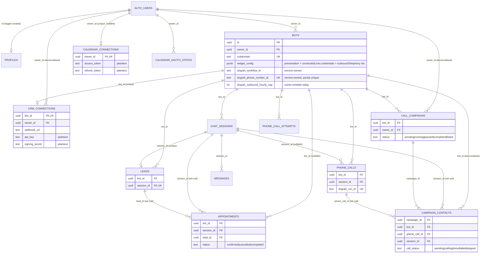

# Stage 1 — Database architecture review

**Date:** 2026-10-26 · **Baseline:** `68c27ae` · **Status:** Inspection and design only. No migration applied, no policy changed, no data touched, no staff account created.

**Source of truth.** This review covers the complete migration chain in `server/supabase/migrations/` (17 files, 520 lines), read in full, cross-checked against every `.from()` and `.rpc()` call in `server/src` and `client/src`. The **deployed** schema, grants and policies were not inspected. Every statement about live behavior is conditional on the deployed database matching this chain (see §8). Also present but **not a migration**: `server/supabase/alter_table.sql` (a duplicate of `20260616132045`).

Companion: [01-repository-setup-plan.md](01-repository-setup-plan.md).

---

## 1. Table inventory (existing)

All tables are in `public`. The tenant is the owning `auth.users.id` (see §5).

| # | Table | Purpose | Tenant anchor | Defined / changed in |
| --- | --- | --- | --- | --- |
| 1 | `profiles` | Display name, company, `plan` text, one row per auth user (created by trigger) | `id = auth.users.id` | `001_schema.sql:8-27` |
| 2 | `bots` | The business agent: persona, knowledge base, widget appearance, allowed domains, **plus** Dograh workflow/number/tool IDs, call limits and inbound throttle state | `owner_id → auth.users` | `001:30-52`; `20260616132045`; `20260617115219`; `20260626120000:7-17`; `20260626130000`; `20260630120000:7-16`; `20260716000000`; `20261008120000` |
| 3 | `chat_sessions` | One conversation (web chat, web voice or phone), `channel ∈ {web, phone}` | `bot_id → bots` | `001:55-71`; `20260626120000:20-21`; `20260618120000` |
| 4 | `messages` | Turns of a session (`sender ∈ {user, bot}`) | `session_id → chat_sessions` | `001:74-94`; `20260618120000` |
| 5 | `leads` | LLM-extracted lead, at most one per session (`session_id UNIQUE`) | `bot_id → bots` **and** `session_id → chat_sessions` | `001:97-116`; `20260723120000` (`email`) |
| 6 | `calendar_connections` | Google/Outlook OAuth tokens in plaintext columns, one per owner | `owner_id → auth.users` (nullable) | `002:3-20`; `003`; `004`; `20260618121000:38-57` (dedupe + `UNIQUE(owner_id)`) |
| 7 | `appointments` | Locally recorded bookings, optional provider `calendar_event_id` | `bot_id → bots` (nullable) | `002:23-47` |
| 8 | `calendar_oauth_states` | Hashed, single-use, expiring OAuth `state` values | `owner_id → auth.users` | `20260618121000:1-36` |
| 9 | `phone_calls` | One row per Dograh run: media URLs, status, cost, ingest state | `bot_id → bots` | `20260626120000:24-48` |
| 10 | `phone_call_attempts` | Accepted inbound/outbound attempts for rolling rate limits | `bot_id → bots` | `20260630120000:22-32` |
| 11 | `crm_connections` | Per-bot CRM webhook URL, API key, signing secret in plaintext | `bot_id → bots` **and** denormalised `owner_id → auth.users` | `20260627140000` |
| 12 | `call_campaigns` | Bulk outbound campaign lifecycle and counters | `bot_id → bots` **and** denormalised `owner_id → auth.users` | `20260716100000:2-24` |
| 13 | `campaign_contacts` | Uploaded contacts and per-contact outcome, links to call/session | `campaign_id → call_campaigns` **and** denormalised `bot_id → bots` | `20260716100000:27-64` |

**Functions**

| Function | Security | Grants | Evidence |
| --- | --- | --- | --- |
| `handle_new_user()` trigger on `auth.users` | `SECURITY DEFINER`, **no `SET search_path`** | default | `001:16-27` |
| `consume_calendar_oauth_state(text, text)` | `SECURITY INVOKER`, `search_path = public` | revoked from `PUBLIC`/`anon`/`authenticated`; `service_role` only | `20260618121000:17-36` |
| `increment_campaign_called_count(uuid)` | `SECURITY DEFINER`, `search_path = public`, **no caller check** | **no revoke**, so `PUBLIC` keeps the default execute grant | `20260716100000:70-80`; `20260720120000:11-17` |

**Indexes** worth knowing: `bots(owner_id)`, `chat_sessions(bot_id)`, `messages(session_id)` (`20260618120000:7-9`); partial unique `bots(dograh_phone_number_id)` (`20260626120000:15-17`); `phone_call_attempts(bot_id, direction, created_at desc)`; `call_campaigns(bot_id, created_at desc)`; `campaign_contacts(campaign_id, row_index)` and partial `(phone_call_id)`. Unique constraints: `bots.subdomain`, `leads.session_id`, `phone_calls.dograh_run_id`, `crm_connections.bot_id`, `calendar_connections.owner_id`.

---

## 2. Entity-relationship diagram (existing)



All foreign keys are single-column. **No foreign key checks that two links on one row belong to the same tenant.** That gap is the central finding of §5.

---

## 3. Explicit entity mapping

| Requested entity | Existing table(s) | Owner path | Notes |
| --- | --- | --- | --- |
| Profiles / users | `auth.users` (Supabase Auth), `profiles` | self | `profiles` has **no RLS** (§4). `plan` is unused by code; grep found no read of `profiles` in `server/src` or `client/src`. There is **no role/admin column**, and none should be added (§7). |
| Bots | `bots` | `owner_id` | Mixes three concerns: customer settings, service-owned provider mappings, and spend limits (§4, G3). |
| Sessions | `chat_sessions` | via `bot_id` | Shared by web chat, web voice and phone. |
| Messages | `messages` | via `session_id → bot_id` | |
| Leads | `leads` | via `bot_id`, **and** `session_id` | Two independent paths to a bot can disagree (I6). |
| Calendar connections | `calendar_connections` | `owner_id` (per owner, **not** per bot) | All of an owner's bots share one calendar. The browser writes OAuth tokens directly (`client/src/hooks/useAuth.ts:19-29`). |
| Appointments | `appointments` | via `bot_id` | `session_id`/`lead_id` are not checked against `bot_id` (I8). |
| Phone calls | `phone_calls` | via `bot_id` | Written only by the service role (`20260626120000:43-48`). |
| Call attempts | `phone_call_attempts` | via `bot_id` | RLS on, no policy, so it is service-role only. Correct as designed. |
| Campaigns | `call_campaigns` | `owner_id` **and** `bot_id` | RLS checks `owner_id` only (S02). |
| Campaign contacts | `campaign_contacts` | via `campaign_id`, **and** `bot_id`, `phone_call_id`, `session_id` | RLS checks the campaign only (S02/S03). |
| CRM connections | `crm_connections` | `owner_id` **and** `bot_id` | RLS checks `owner_id` only (S01). |
| OAuth state | `calendar_oauth_states` | `owner_id` | Correctly locked to the service role. |

---

## 4. Access boundaries and existing RLS

### 4.1 Who touches what (from code)

| Table | Browser (publishable key + user JWT) actually does | API (service role) does | RLS policy for `authenticated` | Gap |
| --- | --- | --- | --- | --- |
| `profiles` | nothing | nothing (trigger inserts) | **RLS not enabled** | **G1** |
| `bots` | select own, insert, update (incl. `widget_config`, `dograh_phone_number`), delete (`client/src/hooks/useBots.ts:33-96`; `services/seedDemo.ts:97`) | read/write all columns | `owner_bots_crud`: ALL where `owner_id = auth.uid()` (`001:47-49`) | **G3**, G9 |
| `chat_sessions` | select; insert (demo seed) | read/write | owner select/insert via bot (`001:68-71`, `20260618120000:12-16`) | — |
| `messages` | select; insert (demo seed) | read/write | owner select/insert via session→bot | — |
| `leads` | select, update `lead_score`/`sentiment`, delete (`LeadTable.tsx:84-155`); insert (seed) | upsert on `session_id` (`leadController.ts:270-283`) | `owner_leads`: ALL where `bot_id` is owned (`001:114-116`) | G6 |
| `calendar_connections` | **upsert raw provider tokens** (`useAuth.ts:19-29`) | read/refresh tokens | ALL where `owner_id = auth.uid()`, no explicit `WITH CHECK` (USING is reused) (`002:17-20`) | **G4** |
| `appointments` | select | insert/update | ALL where `bot_id` is owned (`002:40-47`) | G7 |
| `calendar_oauth_states` | — | insert/consume | none; table grants revoked (`20260618121000:14-15`) | — (good) |
| `phone_calls` | select (`useLeads.ts:86`, `PlansView.tsx:55`) | insert/update | owner SELECT only (`20260626120000:45-48`) | — |
| `phone_call_attempts` | — | insert/select | none (deny) | — (good) |
| `crm_connections` | — (via API only, `client/src/lib/crmApi.ts`) | read/write | ALL where `owner_id = auth.uid()` (`20260627140000:16-20`) | **G2** |
| `call_campaigns` | — (via API only) | read/write, startup resume | ALL where `owner_id = auth.uid()` (`20260716100000:20-22`) | **G2** |
| `campaign_contacts` | select `session_id` (`useLeads.ts:51`) | read/write | ALL where the campaign is owned (`20260716100000:50-57`) | **G2** |
| RPC `increment_campaign_called_count` | — | called by runner/sync | n/a, executable by `PUBLIC` | **G5** |

**Key observation.** The browser uses far less than RLS permits. `crm_connections`, `call_campaigns` and `campaign_contacts` are written only through the API, yet RLS grants owners full direct write. Likewise for `appointments` writes and most `bots` columns. Every such grant is attack surface with no product need. This is how S01/S02 become reachable.

### 4.2 Authorization gaps relevant to the new structure

| ID | Gap | Evidence | Audit ref | Why it matters for web/admin/api split |
| --- | --- | --- | --- | --- |
| **G1** | `profiles` has no RLS. Under Supabase's default `public` grants, `anon` and `authenticated` can read and modify every profile (**deployed grants unverified**) | `001:8-14`; no `ENABLE ROW LEVEL SECURITY` for `profiles` anywhere in the chain | S14 | Anything staff-related must **not** be stored on `profiles`. Customer-writable columns can never confer authority |
| **G2** | Child rows with a denormalised `owner_id` or `bot_id` are checked on one column only. An owner can attach their row to another tenant's bot, or attach a contact to a foreign call/session | `20260627140000:16-20`; `20260716100000:20-22,50-57` | S01, S02, S03 | Privileged workers (and a future admin API) read these links as trusted |
| **G3** | `bots` row-level ownership lets the browser write service-owned columns: `dograh_*` IDs, tool UUIDs, `dograh_inbound_active_workflow`, `dograh_inbound_rate_limited_until`, hourly caps, and `widget_config.connectedLines[].credentials` / `outboundTelephony.{telephonyConfigId, phoneNumberId}`. The web app itself writes `dograh_phone_number` (`useBots.ts:37,72`) and sends the whole `widget_config` object back | `20260626120000:7-11`; `20260630120000:7-16`; `server/src/modules/phone-calls/dograhController.ts:1817-1834,1335-1338` | S04, S05, S08, S19 | The contracts split (repo plan §4) must keep these types out of browser packages |
| **G4** | Provider secrets (calendar tokens, CRM `api_key`/`signing_secret`) are plaintext columns readable by the owning browser session. The browser **writes** calendar tokens | `002:7-8`; `20260627140000:8-9`; `useAuth.ts:19-29` | S19 | Secrets must live behind the API only; no browser package may type them |
| **G5** | `increment_campaign_called_count` is `SECURITY DEFINER` with no ownership check and no `REVOKE`. Any role with default execute can bump any campaign's counter | `20260720120000:11-17` | S26 | Low impact, but the same pattern must not be copied for admin RPCs |
| **G6** | `leads.bot_id` and `leads.session_id` are independent. Nothing guarantees `session.bot_id = lead.bot_id`. The service upsert rewrites `bot_id` on conflict (`leadController.ts:270-283`) | `001:99-100` | S03-family | A lead could be counted under the wrong tenant in admin aggregates |
| **G7** | `appointments.session_id` / `lead_id` are not checked against `appointments.bot_id`. Owners can insert or update `status='confirmed'` directly | `002:23-47` | S18, S21 | Admin "verified booking" views cannot trust these links |
| **G8** | `handle_new_user()` is `SECURITY DEFINER` without `SET search_path` | `001:16-23` | — (new) | Hardening item. Low risk in Supabase's default schema setup, but needs fixing before any staff schema is added |
| **G9** | Bot deletion from the browser cascades local rows but leaves Dograh workflows/numbers and CRM/recording copies behind | `useBots.ts:90-96`; `ON DELETE CASCADE` on all children | Q15 | Admin "tenant offboarding" needs a server-side lifecycle, not direct deletes |
| **G10** | No explicit `GRANT`/`REVOKE` on any table except `calendar_oauth_states`. Effective access depends on Supabase defaults plus RLS | whole chain | S14/S26 | Real-role SQL tests are the only way to prove isolation (§6.3) |

Positive controls to keep: owner-scoped sessions/messages after `20260618120000`; public insert policies removed; `calendar_oauth_states` and `consume_calendar_oauth_state` correctly restricted; `phone_calls` and `phone_call_attempts` writable by the service role only; partial unique on the Dograh number.

---

## 5. Tenant model and same-tenant invariants

### 5.1 Decision: keep owner-as-tenant initially

**Recommendation: keep it.** Every policy, API check (`loadOwnedBot`, `requireAuth`) and denormalised column uses `auth.users.id` as the tenant. No code path, UI or table models multiple users per business. Introducing `tenants`/`memberships` now would rewrite every policy and API check without any product requirement driving it, and would make the current isolation repairs harder to review.

**Tenant identifier** (as used throughout this document) = `bots.owner_id` = `auth.users.id`.

**Trigger to revisit.** A confirmed requirement for more than one login per business (team seats, agency access) or for transferring a business between users. The migration path is in §5.3, kept separate.

### 5.2 How every tenant-owned record reaches its owner

| Record | Path to tenant | Same-tenant invariant that must hold (none is enforced by the DB today) |
| --- | --- | --- |
| `bots` | `owner_id` | — (root) |
| `chat_sessions` | `bot_id → bots.owner_id` | — |
| `messages` | `session_id → chat_sessions.bot_id → owner` | — |
| `leads` | `bot_id → owner` | **I6** `leads.bot_id = chat_sessions(session_id).bot_id` |
| `appointments` | `bot_id → owner` | **I8a** `session_id` null or `session.bot_id = appointments.bot_id`; **I8b** `lead_id` null or `lead.bot_id = appointments.bot_id`; **I8c** `bot_id NOT NULL` |
| `phone_calls` | `bot_id → owner` | **I7** `session_id` null or `session.bot_id = phone_calls.bot_id` |
| `phone_call_attempts` | `bot_id → owner` | — |
| `crm_connections` | `bot_id → owner` (and `owner_id`) | **I1** `crm_connections.owner_id = bots(bot_id).owner_id` |
| `call_campaigns` | `bot_id → owner` (and `owner_id`) | **I2** `call_campaigns.owner_id = bots(bot_id).owner_id` |
| `campaign_contacts` | `campaign_id → owner` (and `bot_id`) | **I3** `contact.bot_id = campaign.bot_id`; **I4** `phone_call_id` null or `phone_call.bot_id = contact.bot_id`; **I5** `session_id` null or `session.bot_id = contact.bot_id` |
| `calendar_connections` | `owner_id` | **I9** (application-level) a bot may only use its own owner's connection; `owner_id NOT NULL` |
| `calendar_oauth_states` | `owner_id` | — |
| Provider resources inside `bots` | `owner_id` | **I10** a Dograh workflow, telephony config or number ID may be referenced only by bots of one tenant, and only if the platform allocated it to that tenant (S04/S05). Not expressible today because the IDs live in owner-writable columns and JSON |

### 5.3 How the invariants should be enforced (design, not applied)

Use **composite foreign keys**, which are declarative, indexed and need no triggers:

```sql
-- illustrative only — NOT a migration
ALTER TABLE bots           ADD CONSTRAINT bots_id_owner_key      UNIQUE (id, owner_id);
ALTER TABLE chat_sessions  ADD CONSTRAINT chat_sessions_id_bot   UNIQUE (id, bot_id);
ALTER TABLE phone_calls    ADD CONSTRAINT phone_calls_id_bot     UNIQUE (id, bot_id);
ALTER TABLE call_campaigns ADD CONSTRAINT call_campaigns_id_bot  UNIQUE (id, bot_id);
ALTER TABLE leads          ADD CONSTRAINT leads_id_bot           UNIQUE (id, bot_id);

ALTER TABLE crm_connections   ADD CONSTRAINT crm_bot_owner_fk
  FOREIGN KEY (bot_id, owner_id) REFERENCES bots (id, owner_id) ON DELETE CASCADE NOT VALID;      -- I1
ALTER TABLE call_campaigns    ADD CONSTRAINT campaign_bot_owner_fk
  FOREIGN KEY (bot_id, owner_id) REFERENCES bots (id, owner_id) ON DELETE CASCADE NOT VALID;      -- I2
ALTER TABLE campaign_contacts ADD CONSTRAINT contact_campaign_bot_fk
  FOREIGN KEY (campaign_id, bot_id) REFERENCES call_campaigns (id, bot_id) ON DELETE CASCADE NOT VALID; -- I3
ALTER TABLE campaign_contacts ADD CONSTRAINT contact_call_bot_fk
  FOREIGN KEY (phone_call_id, bot_id) REFERENCES phone_calls (id, bot_id)
  ON DELETE SET NULL (phone_call_id) NOT VALID;                                                   -- I4 (PG15+ column list)
-- … same pattern for I5, I6, I7, I8a, I8b
-- then: ALTER TABLE … VALIDATE CONSTRAINT …;   only after the pre-check below returns zero rows
```

- `ON DELETE SET NULL (col)` with a column list keeps `bot_id` intact. It needs Postgres 15 or later. The CLI cache reports `17.6.1.127` (`server/supabase/.temp/postgres-version`), to be confirmed on each project.
- **Pre-check before validation.** For each invariant, run a read-only query that counts violating rows, for example `select count(*) from crm_connections c join bots b on b.id = c.bot_id where c.owner_id <> b.owner_id`. Non-zero results go to a human triage list. Never auto-delete or auto-reassign rows.
- RLS is tightened to match actual browser usage (§4.1). Owners lose direct INSERT/UPDATE/DELETE on `crm_connections`, `call_campaigns` and `campaign_contacts`, and direct writes to service-owned `bots` columns (via column privileges or by moving those columns into a service-owned table, see §9).
- This belongs to the S01/S02/S04 remediation work package. It is listed here so the repository structure (migration location, test location, DB layer) is designed for it.

### 5.4 Future multi-user migration (only if required, a separate proposal)

1. Add `tenants(id, name, created_at)` and `tenant_memberships(tenant_id, user_id, role, created_at, UNIQUE(tenant_id, user_id))`.
2. Backfill one tenant per existing owner with **`tenants.id = owner_id`**, so every existing ID remains a valid tenant ID, plus an `owner` membership for that user.
3. Add `bots.tenant_id` (backfilled `= owner_id`), keeping `owner_id` for one release as a compatibility column.
4. Replace `owner_id = auth.uid()` in policies with `public.is_tenant_member(tenant_id)` (`SECURITY DEFINER`, `search_path` set, `STABLE`), and repoint composite keys to `(id, tenant_id)`.
5. Move `calendar_connections` from per-owner to per-tenant (or per-bot) as a product decision.
6. Drop `owner_id` only after all readers have moved.

This touches every policy and API ownership check. It is a multi-PR effort and is **not** part of Stage 1.

---

## 6. Proposed database-access layer and migration location

### 6.1 Migration location

| Item | Proposal |
| --- | --- |
| Canonical path | Repo-root `supabase/` (`supabase/migrations`, `supabase/functions`, `supabase/config.toml`), moved from `server/supabase` in repo-plan step 5. The database serves web (RLS), api and admin, so it is not owned by one app. |
| History | `git mv` only. File names and contents stay unchanged, so the remote `supabase_migrations.schema_migrations` history still matches. Verify with `supabase migration list --linked` before and after. |
| Naming | New migrations use only `YYYYMMDDHHMMSS_description.sql` via `supabase migration new`. The four legacy `00N_` files stay as they are. |
| Stray SQL | `server/supabase/alter_table.sql` duplicates `20260616132045`. Move it to `supabase/legacy/` with a note. Do not rename it into the migration chain. |
| CLI state | `supabase/.temp/` untracked. Each developer runs `supabase link` for their target project. |
| Tests | `supabase/tests/*.sql` using pgTAP via `supabase test db`. This is built into the CLI, so no npm dependency is added. These are the real-role tests for G1–G10. |
| Types | `supabase gen types typescript --local > packages/contracts/src/database.ts`. Row types are not secrets and are browser-safe. Regenerated in CI and diffed to detect drift. |

### 6.2 Server-only data-access layer

Today there are **six** independently created service-role clients (repo plan §2). Proposed layout inside `apps/api` (promoted to `packages/db` only when a second server runtime exists):

```text
apps/api/src/db/
  client.ts          ← the ONLY createClient(SERVICE_ROLE) in the codebase; lazy singleton
  scope.ts           ← TenantScope { ownerId } type + assertSameTenant() helpers
  bots.ts            ← getOwnedBot(scope, botId), getBotForWorker(botId) (explicitly cross-tenant, named so)
  campaigns.ts  contacts.ts  calls.ts  leads.ts  sessions.ts  crm.ts  calendar.ts
  index.ts           ← explicit exports; no re-export of the raw client
```

Rules:

1. **Customer-scoped functions take a `TenantScope` as the first parameter.** Every query includes `owner_id` (or the bot→owner join). It is impossible to call them without a scope.
2. **Worker and admin functions that are intentionally cross-tenant are named that way** (`…ForWorker`, `…ForStaff`). They must re-check the invariants in §5.2 on the rows they read, because the service role bypasses RLS.
3. Admin code receives a **staff actor context** (§7) and calls the same repositories. It never gets the raw client.
4. The raw client is not exported from `index.ts`. `scripts/check-boundaries.mjs` fails if `@supabase/supabase-js` with a service key is imported outside `apps/api/src/db/client.ts`.
5. Browser apps never import this layer. `apps/web` keeps its publishable-key client for the tables in §4.1. `apps/admin` has no database client.

Repo-plan step 6 introduces only `client.ts` (replacing the 6 sites, behavior-neutral). Repository functions are added module by module as part of the remediation work, not in Stage 1.

### 6.3 Keeping privileged material out of the browser

| Material | Where it may live | Must never appear in |
| --- | --- | --- |
| `SUPABASE_SERVICE_ROLE_KEY`, Gemini/Groq/Dograh keys, `PHONE_TOOLS_API_KEY` | `apps/api` env/SSM | any `VITE_*`, `packages/*`, web/admin bundles |
| Calendar tokens, CRM `api_key`/`signing_secret`, carrier credentials | DB columns readable by the service role only (target state) | browser queries, contracts types, admin responses |
| Provider mappings (Dograh workflow/config/number/tool IDs) | Service-owned columns/table written only by the API (target state) | customer-writable JSON, browser `update` payloads |
| Staff identity, roles, audit | Non-exposed schema (§7) | `public` schema, `profiles`, customer JWT claims |

---

## 7. Minimum future staff identity, roles and audit (proposed, NOT existing)

Nothing in the current schema represents staff. `profiles.plan` is a customer field. An `is_admin` column, a JWT claim set by the customer auth project, or the existence of `apps/admin` **does not establish authorization** and must not be used as such.

Placement: a separate schema (`staff`) that is **not** in PostgREST's exposed schemas, with no grants to `anon`/`authenticated`. Only the API's server role can read it, and every route enforces deny-by-default permissions.

| Proposed table | Minimum columns | Invariants |
| --- | --- | --- |
| `staff.principals` | `id uuid pk`, `issuer text`, `subject text`, `email text`, `display_name`, `status ∈ {active, suspended, revoked}`, `created_at`, `revoked_at` | `UNIQUE(issuer, subject)`. Identity comes from the staff IdP, **not** customer Supabase Auth. No link to `auth.users`. |
| `staff.role_assignments` | `id`, `principal_id fk`, `role ∈ {read_only, support, super_admin}`, `granted_by fk principals`, `granted_at`, `revoked_at`, `reason text not null` | Active roles are the rows where `revoked_at is null`. A grant requires a different principal as `granted_by` (no self-grant check constraint). |
| `staff.audit_events` | `id bigserial`, `occurred_at`, `actor_principal_id`, `actor_session_id`, `action text`, `tenant_owner_id uuid null`, `resource_type`, `resource_id`, `reason`, `request_id`, `decision ∈ {allowed, denied}`, `outcome ∈ {succeeded, failed, pending}`, `metadata jsonb` (sanitised, no secrets or transcripts) | Insert-only: `REVOKE UPDATE, DELETE, TRUNCATE` from every app role, plus a trigger that rejects updates and deletes. This is **not immutable** against the database owner, so a separate append-only export (audit doc 06) is still required before claiming immutability. |

Deferred until the IdP and session design are chosen: `staff.sessions` (only if the API holds server-side sessions instead of verifying IdP tokens per request). Deferred until admin mutations exist: `tenant_control_state`, `provider_resource_allocations`, budgets/ledger, `support_delegations` (doc 06).

The admin API identifies tenants by `bots.owner_id`, consistent with §5.1.

---

## 8. Environment and project verification (blocker before any DB work)

The repository points at **three different Supabase projects**:

| Reference | Project ref | Evidence |
| --- | --- | --- |
| CLI link used by `npm run db:migrate` (`supabase db push`) | `gatzlksagxpdqqonssfq` | `server/supabase/.temp/project-ref`, `server/supabase/config.toml:1` |
| Staging web build | `lckiehhthevtykulfbvw` | `client/Dockerfile.staging:28` |
| Production web build (also the local-dev Dockerfile default) | `xdwcrsydlzprtldkwqzh` | `client/Dockerfile.prod:28`, `client/Dockerfile:27` |

Before any migration work: confirm which project is development, staging and production; whether `gatzlks…` is still in use; and which migrations each project has applied (`supabase migration list` per project, read-only). Export each project's actual policies and grants read-only (`select * from pg_policies`, `information_schema.role_table_grants`, `pg_proc` ACLs) and compare them with §4. Until then, every gap above is "per the migration chain".

---

## 9. Current vs proposed schema

| Area | Current (existing) | Proposed (design only) | Introduced by |
| --- | --- | --- | --- |
| Tenant model | Owner-as-tenant (`auth.users.id`) | **Unchanged** | — |
| `profiles` | No RLS | RLS: owner select/update of `full_name`/`company` only; `plan` server-owned | S14 work |
| Same-tenant links | Single-column FKs only | Composite FKs I1–I8 (`NOT VALID` → pre-check → `VALIDATE`) | S01/S02/S03 work |
| `bots` | Customer settings + provider mappings + limits in one row, all owner-writable; credentials inside `widget_config` | Customer settings stay in `bots`. Provider mappings and limits move to a service-owned `bot_integrations` (1:1, service-role write, owner select of non-secret fields). Credentials leave JSON | S04/S05/S19 work |
| Secrets | Plaintext columns, owner-readable; browser writes calendar tokens | Service-role-only access (column grants or a separate table). Token exchange happens only via the API callback (which already exists, `server/src/controllers/calendarController.ts`). Encryption or secret references as a follow-up | S19 work |
| Child-table RLS | Owner ALL on CRM/campaigns/contacts/appointments | Owner SELECT only where the browser reads. Writes through the API | S01/S02 work |
| RPCs | `increment_campaign_called_count` callable by `PUBLIC` | `REVOKE` from `PUBLIC`/`anon`/`authenticated`; `GRANT` to `service_role` | S26 work |
| `handle_new_user` | `SECURITY DEFINER`, no `search_path` | `SET search_path = public, pg_temp` | G8 |
| Nullable anchors | `appointments.bot_id`, `calendar_connections.owner_id` nullable | `NOT NULL` after a pre-check | with I8 |
| Campaign state | One `paused` status for both manual and throttle pauses | Distinct states/reason and a versioned transition | S09/Q02 work |
| Staff | None | `staff.principals`, `staff.role_assignments`, `staff.audit_events` in a non-exposed schema | Admin foundation (after Stage 1) |
| Migrations | `server/supabase/migrations`, CLI state tracked | `supabase/migrations` at root, `.temp` untracked, pgTAP tests, generated types | Repo plan steps 1 and 5 |
| Data access | Six service-role clients across the API | One factory and scoped repositories in `apps/api/src/db` | Repo plan step 6 (factory only) |

Everything in the "Proposed" column except the last two rows is outside Stage 1 and needs its own approved work package with migration, pre-check queries, real-role tests and a rollback note.

---

## 10. Acceptance checks for this review

- [ ] Each environment's Supabase project ref is confirmed (§8).
- [ ] The read-only policy and grant export from staging matches §4, or the differences are documented.
- [ ] The tenant-model decision is recorded: owner-as-tenant kept (recommended).
- [ ] The invariant list I1–I10 is accepted as the target for the S01–S05 remediation package.
- [ ] Staff entities in §7 are accepted as the minimum, with the IdP choice still open.
- [ ] Migration location and DB-layer placement (§6) are accepted for repo-plan steps 5–6.

## 11. Decisions needed

1. **Owner-as-tenant stays** for now; multi-user (§5.4) only when there is a product requirement. Recommended.
2. **Composite FKs** (not triggers) as the invariant mechanism. Recommended.
3. **Service-owned `bot_integrations` table** rather than column-level grants on `bots`. Recommended: it is easier to reason about and to test. The alternative is column privileges, which have less churn but are easier to regress.
4. **Staff identity provider**: corporate OIDC (recommended in audit 06) or a dedicated staff Supabase project. Needed before §7 becomes a migration.
5. **Who confirms the project mapping and runs the read-only grant export** (§8).

STOP: no migration, policy change, backfill or staff account will be created until these are approved through a separate work package.
